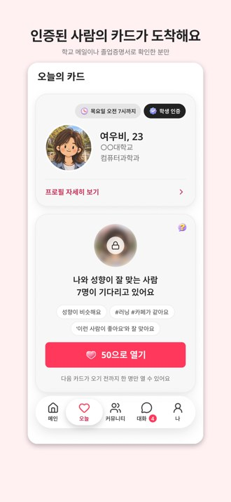
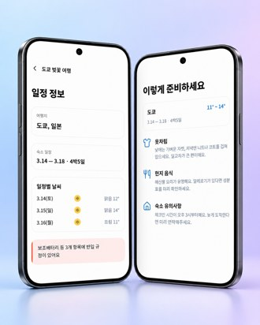
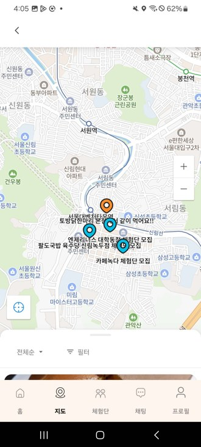

# 안녕하세요, 불편을 찾아 직접 출시하고 숫자로 확인하는 **이준석**입니다.

- 대학생 소개팅 웹을 5일 만에 만들어 55일 동안 운영 · 신청자 80명 · 매출 60만 원 이상
- 4인 팀의 팀장으로 여행 준비물 앱 MyBag을 Google Play에 출시

 

## 🏆 만든 것들

<table>
<tr>
<td width="180" align="center"></td>
<td>

### [CampusMate](https://github.com/Ju-unn/Campus_mate_compose) 💘
**나이 대신 잘 맞는 사람을 하루 한 명 추천하는 대학생 매칭 앱**

소개팅 웹을 운영해 보니 나이대 조건만으로는 잘 맞는 상대를 고르기 어려웠어요(매칭 성공률 27.4%). 그래서 성향, 관심사, **자기소개 글의 뜻**을 비교하고 흡연 · 종교 같은 생활 조건은 감점하는 점수를 설계했어요. 출시 전이라 정답 기록이 없어서 **가상 계정 1000개**로 검증하며 10차례 고쳤고, 취향이 반대인 상대가 유료 카드에 드는 비율을 **21.6%에서 5.8%로** 줄였습니다. 7주 만에 앱과 서버를 만들어 두 스토어에 제출했어요.

    
 [💻 코드](https://github.com/Ju-unn/Campus_mate_compose) · App Store 심사 통과 · Google Play 심사 중

</td>
</tr>

<tr>
<td width="180" align="center"><h1>💌</h1>소개팅 웹</td>
<td>

### 대학생 소개팅 웹 💌
**구글폼으로 받던 소개팅을 웹으로 옮긴 매칭 서비스**

친구가 대학교 소개팅을 구글폼, 엑셀, 카톡으로 운영하고 있었어요. 신청자가 늘면 감당하기 어려울 거라 보고 **웹으로 옮기자고 제안**했습니다. 신청부터 매칭, 소개서 수락, 통계까지 어드민 하나로 옮겨 **5일 만에** 첫 버전을 배포했어요. 모집 · 마케팅은 친구가, 개발은 제가 맡아 **55일 동안 신청자 80명, 매출 60만 원 이상**을 만들었습니다.

    
 2025.11 ~ 12 운영 · 코드는 비공개

</td>
</tr>

<tr>
<td width="180" align="center"></td>
<td>

### [여행가방 대신 싸줘 (MyBag)](https://github.com/Ju-unn/MyBagHackathon) 🧳
**일정 캡처만 올리면 AI가 준비물을 골라 주는 여행 앱**

여행을 갈 때마다 항공 반입 규정, 준비물, 날씨를 하나씩 찾느라 시간이 많이 들었어요. 그래서 4인 팀으로 만들어 출시했습니다. 저는 **서버를 맡은 팀장**으로 역할과 규칙을 먼저 합의하고, 방장 · 팀원 · 다시 들어온 팀원이 **같은 체크리스트**를 보게 했어요. 서버(API 30개, 테이블 12개)는 혼자 만들었습니다.

    
 [▶️ Google Play](https://play.google.com/store/apps/details?id=com.mybagteam.mybag) · [💻 앱](https://github.com/Ju-unn/MyBagHackathon) · [🗄️ 서버](https://github.com/Ju-unn/mybagbackend)

</td>
</tr>

<tr>
<td width="180" align="center"></td>
<td>

### [혼밥모여](https://github.com/Ju-unn/honbabapp) 🍚
**근처에서 같이 밥 먹을 사람을 찾는 모임 앱**

경상도에서 서울로 올라와 혼자 밥을 먹다가, 같이 먹을 사람이 근처에 있으면 좋겠다고 생각했어요. 지도로 주변 밥 모임을 찾고, 처음 만나는 사람끼리 믿을 수 있도록 **QR 출석과 매너 점수**를 넣었습니다. 앱, 서버, DB를 **9개월 동안 혼자** 만들었고, 지도가 화면 범위만 조회하게 바꿔 응답을 **14.98MB → 58.9KB**로 줄였어요(가상 데이터 1만 건으로 로컬에서 잰 값).

    
 [💻 앱](https://github.com/Ju-unn/honbabapp) · [🗄️ 서버](https://github.com/Ju-unn/honbabapp-backend) · 개인 프로젝트 · 미출시

</td>
</tr>

<tr>
<td width="180" align="center"></td>
<td>

### [codex-lean-kit](https://github.com/Ju-unn/codex-lean-kit) 🧰
**AI가 코드를 써도 일하는 순서는 사람이 지휘하게 만드는 Codex 작업 키트**

SK하이닉스 AI 해커톤에 쓰려고 만들었어요. AI로 일하는 평가는 결과물만이 아니라 **일하는 과정**도 봐요. 그래서 질문 → 계획 → 테스트 먼저 → 두 축 리뷰 → 검증 순서를 지키게 하는 **스킬 11개와 역할 3개**를 공개 스킬에서 옮겨 와 Codex에 맞게 고쳤습니다.

  
 [💻 코드](https://github.com/Ju-unn/codex-lean-kit) · [📘 사용 설명서](https://github.com/Ju-unn/codex-lean-kit/blob/main/GUIDE.md)

</td>
</tr>
</table>

 

## 🙋 활동

- 🎤 대학생 대상 클로드 코드 강의
- 🏁 SK하이닉스 AI 해커톤

 

## 🛠 주로 쓰는 것

              
